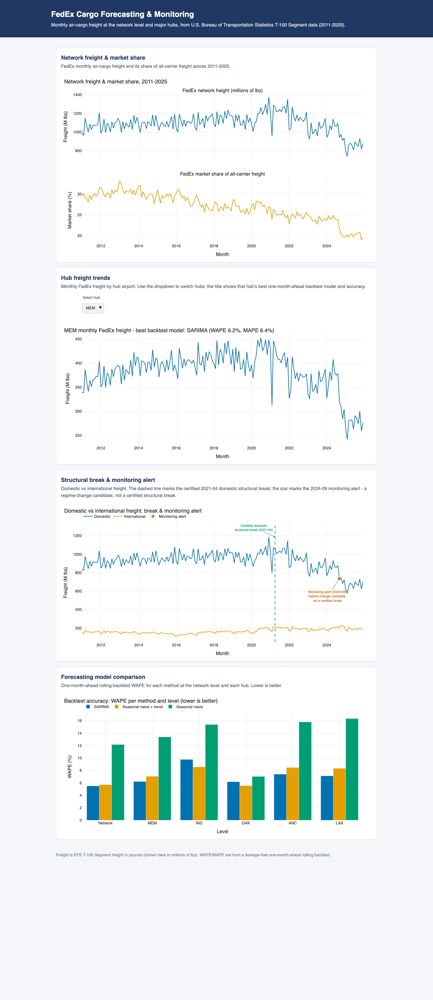

# FedEx Cargo Forecasting & Monitoring

Forecasts FedEx's monthly air-cargo freight volume at both the network level and
its largest hub airports using real U.S. federal flight data, compares several
forecasting methods on a rolling out-of-sample backtest, and runs a
production-style monitoring system that flags when forecast error grows beyond
its normal range — the way a team would catch a real business change, not just
noise, in a live forecasting pipeline.

**Live dashboard:** https://sneha0504.github.io/FedEx_Cargo_Forecasting_Monitoring/



## Key findings (U.S. BTS T-100 Segment data, 2011–2025, 180 months)

- **FedEx air-cargo freight has fallen.** Network freight dropped from **12.78
  billion lbs in 2011 to 10.20 billion lbs in 2025 (−20%)**, and FedEx's share
  of all-carrier air freight slid from a **~30% average in 2011 to ~20% in
  2025** (overall range 19.0%–33.2%).
- **Freight is highly concentrated at Memphis.** The top five hubs by total
  FedEx origin freight are **Memphis 68.8B lbs, Indianapolis 16.2B, Oakland
  7.3B, Anchorage 6.8B, and Los Angeles 5.7B** — Memphis alone is roughly four
  times the next-largest hub.
- **SARIMA is the most accurate one-month-ahead model at the network level**,
  with a **5.5% WAPE**, just ahead of a seasonal-naive-plus-trend method (5.7%)
  and well ahead of a plain seasonal-naive baseline (12.2%). Across hubs the
  winner is SARIMA at MEM (6.2%), ANC (7.4%) and LAX (7.1%), and
  seasonal-naive-plus-trend at IND (8.6%) and OAK (5.6%).
- **Two structural breaks are statistically confirmed** (seasonally-adjusted
  binary-segmentation break test, moving-block bootstrap): a **+28.7% jump in
  international freight in May 2020** (the COVID-era air-freight surge as
  passenger belly capacity vanished), and a **−10.7% step-down in domestic
  freight in April 2021** (post-surge normalization).
- **The monitoring system flags a regime change in September 2024 — about two
  months before a conventional volume review would.** The forecast-error monitor
  raised its single alert in Sept 2024, the month FedEx's domestic air-cargo
  contract with the U.S. Postal Service expired; a plain 2-sigma year-over-year
  volume review did not flag the shift until November 2024. (With only ~16 months
  of data after it, a conservative structural-break test does not yet certify
  Sept 2024 as a permanent break — which is exactly why a real-time error monitor
  is useful: it flags the change as it happens, before statistical confirmation
  is possible.)

## How to run it locally

### 1. Get the data (manual download from BTS)

The data is the U.S. Bureau of Transportation Statistics **T-100 Segment (All
Carriers)** table. Its download form is manual (it can't be fully scripted):

1. Open the download form:
   https://www.transtats.bts.gov/DL_SelectFields.asp?gnoyr_VQ=FMG&QO_fu146_anzr=Nv4%20Pn44vr45
   (confirm the heading reads **T-100 Segment (All Carriers)**, not *Market*).
2. Select the fields: **Freight, Mail, Passengers, Distance, DeparturesPerformed,
   UniqueCarrier, Carrier, CarrierName, Origin (+ city/state/country), Dest (+
   city/state/country), Year, Month, and DataSource** (or "Select all fields").
3. Set filters: **Geography = All**, **Period = All**, and **Year** one at a
   time. Download one zipped CSV **per year for 2011–2025**.
4. Unzip every CSV into `data/raw/` (the files are git-ignored). The pipeline
   auto-detects them.

Full step-by-step is in [docs/data_sources.md](docs/data_sources.md).

### 2. Set up and run the pipeline

Requires Python 3.11+ (`make setup` builds a virtual environment with
`PYTHON_BOOTSTRAP`, default `python3.12`; override if needed).

```bash
make setup       # create .venv and install pinned dependencies
make aggregate   # clean + aggregate to network/hub/domestic-intl monthly series (DuckDB)
make backtest    # rolling one-month-ahead backtest (network + 5 hubs)
make break       # structural break detection (domestic vs international)
make monitor     # forward forecast-error monitoring + lead-time vs a plain review
make excel       # build the Excel report (outputs/FedEx_Forecasting_Report.xlsx)
make dashboard   # build the static dashboard (docs_site/index.html)
make test        # run the test suite
make all         # aggregate -> backtest -> break -> monitor -> excel -> dashboard -> test
```

## Data source

- **U.S. Bureau of Transportation Statistics — T-100 Segment (All Carriers)**,
  https://www.transtats.bts.gov/ (Aviation → Air Carriers → T-100 Segment).
- Monthly freight, mail, and passenger volume by carrier and origin→destination
  airport segment, with a domestic/international indicator.
- **Usage terms:** U.S. Government public-domain data, free to use; no login
  required.

## Tools and libraries

- **Language:** Python 3.11+
- **Data & modeling:** pandas, NumPy, statsmodels (SARIMA), DuckDB (SQL
  aggregation)
- **Reporting:** openpyxl (Excel report with live formulas), Plotly (static
  dashboard)
- **Config & tooling:** PyYAML, pytest, ruff
